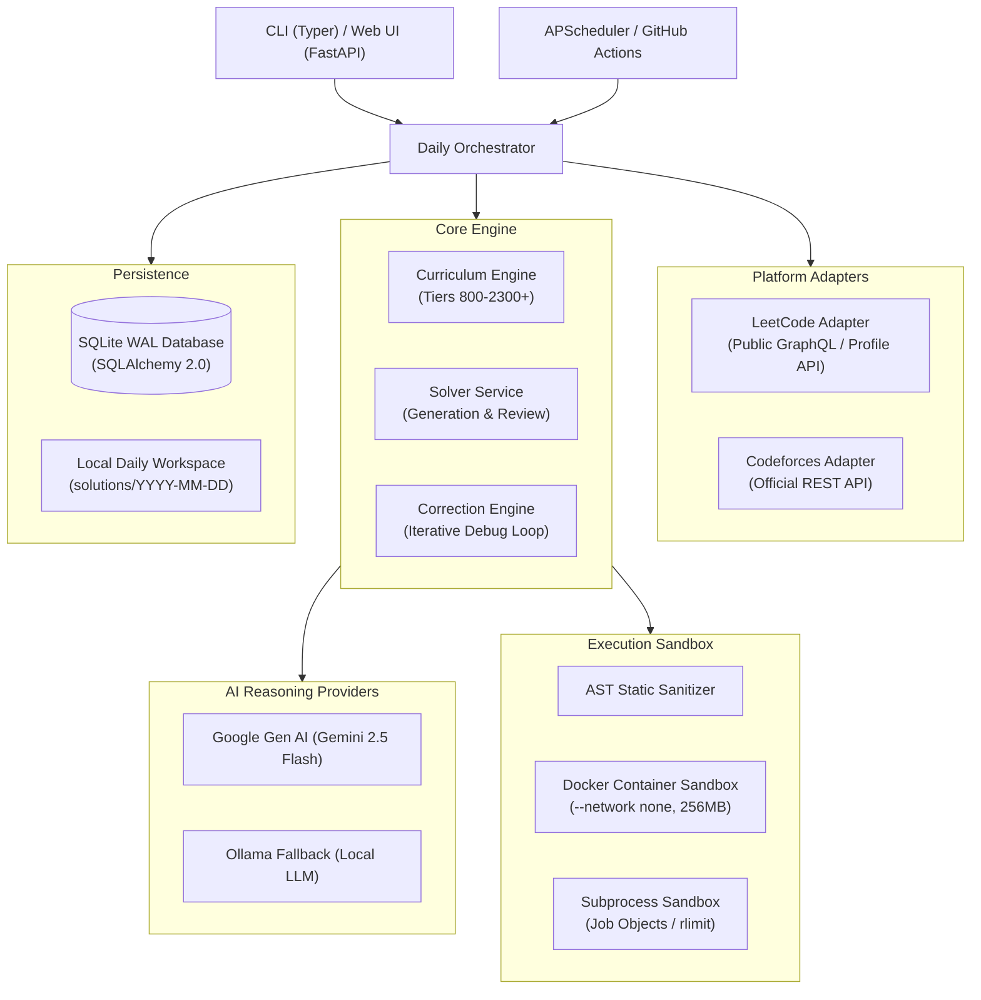
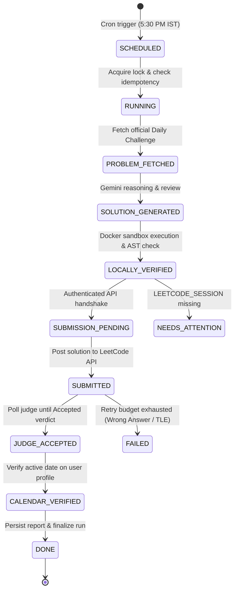

# DC-Agent — Daily Competitive Programming Assistant

[](https://github.com/hardikkaurani/DC-Agent/actions/workflows/ci.yml)
[](https://github.com/hardikkaurani/DC-Agent/actions/workflows/daily.yml)
[](https://www.python.org/downloads/)
[](https://github.com/astral-sh/ruff)
[](http://mypy-lang.org/)
[](https://opensource.org/licenses/MIT)

**DC-Agent** is a production-grade, open-source daily competitive programming assistant powered by Google Gemini. It automates problem selection, multi-perspective algorithmic reasoning, code generation, independent peer review, sandboxed local testing, and automated iterative failure diagnosis—while keeping platform submission strictly user-controlled and 100% compliant with platform Terms of Service.

---

## Configured User Profiles

- **LeetCode**: [`hardikkaurani_`](https://leetcode.com/u/hardikkaurani_/)
- **Codeforces**: [`hkvariant`](https://codeforces.com/profile/hkvariant)

---

## Key Features

### 1. Dual-Platform Problem Selection & Alternation Policy
- **Alternating Daily Policy (Default)**: Alternates cleanly between LeetCode and Codeforces each calendar day (or configurable to single-platform mode).
- **Official LeetCode Daily Challenge**: Target problem matches the official LeetCode Daily Streak Challenge. No random problem selection is ever permitted. Supports user URL confirmation, slug normalization, and public GraphQL metadata lookup.
- **Persistent Codeforces Curriculum**: Automated tier progression across 6 rating brackets (800 to 2300+). Queries official read-only Codeforces REST API, automatically filters out all previously Accepted problems for `hkvariant`, and applies strict promotion (+100 rating on 3 consecutive ACs) and demotion (-100 rating on 2 consecutive fails, floor 800) rules.

### 2. Multi-Stage AI Reasoning Powered by Google Gemini
- Uses the official Google Gen AI Python SDK (`google-genai`) with structured JSON schema outputs.
- Comprehensive 7-stage reasoning pipeline:
  1. **Problem Understanding**: Explicit inputs, outputs, constraints, and implicit edge cases.
  2. **Algorithm Selection & Intuition**: Step-by-step strategy rationale.
  3. **Python 3 Solution Generation**: Clean, idiomatic, typed Python code.
  4. **Independent Code Review**: Autonomous review checking correctness, algorithmic bugs, TLE risks, and memory overhead.
  5. **Sandboxed Test Execution**: Execution against sample and edge test cases.
  6. **Diagnostic Analysis**: Root-cause analysis on test failures (verdict, diff, traceback).
  7. **Iterative Self-Correction**: Bounded retry loop (up to 5 attempts) to fix failing solutions.
- Robust resilience with exponential backoff and randomized jitter on API rate limits (`429`) and server errors (`503`).
- Secondary offline fallback supported via local Ollama instances (`qwen2.5-coder` / `deepseek-coder`).

### 3. Defense-in-Depth Execution Sandboxing
- **Primary Sandbox (Docker)**: Ephemeral Linux container (`python:3.12-slim`), `--network none`, `--read-only` root filesystem, non-root user (`1000:1000`), 256MB memory cap, and 1.0 CPU quota.
- **Secondary Sandbox (Process Isolation)**: When Docker daemon is unavailable, falls back to isolated subprocess runner with:
  - **Windows**: Windows Job Objects via `win32job` enforcing `JOB_OBJECT_LIMIT_PROCESS_MEMORY` (256MB) and `ActiveProcessLimit = 4`.
  - **POSIX**: `resource.setrlimit` enforcing `RLIMIT_AS` (256MB) and `RLIMIT_CPU`.
  - **Wall-Clock Timeout**: Strict 2.0-second timeout.
  - **Output Truncation**: Caps stdout/stderr at 64KB to prevent buffer bombs.
- **Pre-Execution AST Sanitizer**: Blocks forbidden imports (`os`, `sys`, `subprocess`, `socket`, `shutil`, `pty`, `pathlib`) and dangerous builtins (`eval`, `exec`, `open`, `compile`, `__import__`).

### 4. Laptop-Independent Autonomous Cloud Execution
- **Autonomous Cloud Scheduler (GitHub Actions)**: `.github/workflows/daily.yml` executes autonomously every day at **5:30 PM Asia/Kolkata** (12:00 UTC). Runs in cloud infrastructure completely independent of your personal laptop (whether sleeping, turned off, or disconnected).
- **Authenticated LeetCode Submission & Judge Polling**: Submits verified solutions using configured `LEETCODE_SESSION` and `LEETCODE_CSRF_TOKEN`, polls the official judge for terminal verdict, and conducts bounded retries upon Wrong Answer or Time Limit Exceeded.
- **Green Calendar Verification**: Directly inspects the user profile activity calendar to verify that the canonical date in `Asia/Kolkata` is officially marked active before marking the run `DONE`.
- **Durable Cloud Persistence**: Full PostgreSQL support (via `psycopg[binary]`) alongside local SQLite WAL mode, preventing state loss across cloud runners.
- **Local APScheduler Daemon**: Background runner for local environments scheduled daily at `17:30` IST.

### 5. Localhost Web Dashboard
- Embedded, responsive single-page dashboard served via FastAPI at `http://127.0.0.1:8000`.
- Real-time status cards (current curriculum tier, streak, today's problem, daily run status).
- Interactive session history with collapsible code inspection, review reports, and test diagnostics.

### 6. Strict Platform Integrity & Safety
- **No Password or Cookie Storage**: Never asks for, stores, or logs account passwords or session cookies.
- **No Scraping or CAPTCHA Bypass**: Respects robots.txt, Cloudflare WAF, and platform Terms of Service.
- **User-Controlled Submissions**: CLI opens the official submission page in your default browser and copies the solution to your clipboard. Submissions remain user-controlled.
- **No Fake Accepted Verdicts**: A problem is never marked Accepted without platform verification (polling recent submissions API) or explicit user confirmation.

---

## Architectural Overview



---

## Codeforces Rating Curriculum

| Tier | Rating Range | Core Focus Areas | Promotion Criteria | Demotion Criteria |
|:---:|:---:|:---|:---|:---|
| **1** | 800 – 1000 | Basic implementation, math, conditions | 3 consecutive Accepted $\rightarrow$ +100 | None (Floor 800) |
| **2** | 1100 – 1300 | Greedy algorithms, sorting, two pointers | 3 consecutive Accepted $\rightarrow$ +100 | 2 consecutive Fails $\rightarrow$ -100 |
| **3** | 1400 – 1600 | Binary search, number theory, strings | 3 consecutive Accepted $\rightarrow$ +100 | 2 consecutive Fails $\rightarrow$ -100 |
| **4** | 1700 – 1900 | Dynamic programming, graph traversals, trees | 3 consecutive Accepted $\rightarrow$ +100 | 2 consecutive Fails $\rightarrow$ -100 |
| **5** | 2000 – 2200 | Segment trees, bitmask DP, flows | 3 consecutive Accepted $\rightarrow$ +100 | 2 consecutive Fails $\rightarrow$ -100 |
| **6** | 2300+ | Advanced data structures, combinatorics, FFT | Tier Mastered | 2 consecutive Fails $\rightarrow$ -100 |

---

## Installation & Setup

### 1. Prerequisites
- **Python 3.12+**
- **uv** (recommended): `curl -LsSf https://astral.sh/uv/install.ps1 | iex` (Windows) or `curl -LsSf https://astral.sh/uv/install.sh | sh` (Linux/macOS)
- **Docker** (optional, recommended for maximum sandboxed isolation)
- **Google Gemini API Key**: [Get an API Key](https://aistudio.google.com/)

### 2. Clone and Install
```bash
git clone https://github.com/hardikkaurani/DC-Agent.git
cd DC-Agent

# Sync all dependencies using uv
uv sync
```

### 3. Environment Configuration
Copy `.env.example` to `.env`:
```bash
cp .env.example .env
```
Edit `.env` and fill in your Gemini API key:
```env
AI_PROVIDER=gemini
GEMINI_API_KEY=your_actual_gemini_api_key_here
GEMINI_MODEL=gemini-2.5-flash

CODEFORCES_USERNAME=hkvariant
LEETCODE_USERNAME=hardikkaurani_

DAILY_POLICY=alternating
TIMEZONE=Asia/Kolkata
DAILY_RUN_TIME=17:15
SANDBOX_BACKEND=subprocess
```

---

## CLI Command Reference

DC-Agent provides 19 commands organized logically:

### Initialization & System Status
```bash
# Initialize SQLite database and verify accounts
uv run dc-agent init

# Show system status, configured accounts, and scheduler state
uv run dc-agent status

# Show current curriculum tier, rating, and streak stats
uv run dc-agent curriculum
```

### Daily Workflow
```bash
# Run today's end-to-end daily problem session
uv run dc-agent daily

# Resume an interrupted daily session
uv run dc-agent daily --resume

# Force a specific platform for today
uv run dc-agent daily --platform codeforces
uv run dc-agent daily --platform leetcode
```

### LeetCode Assistance
```bash
# Open user's official LeetCode profile page
uv run dc-agent leetcode open-profile

# Set today's challenge by official URL
uv run dc-agent leetcode set-daily --url "https://leetcode.com/problems/two-sum/"

# Set today's challenge by problem slug
uv run dc-agent leetcode set-daily --slug "two-sum"

# Verify recent LeetCode submissions via public profile API
uv run dc-agent leetcode verify
```

### Codeforces Integration
```bash
# Fetch and display the next recommended Codeforces challenge
uv run dc-agent codeforces next

# Check verdict of recent submission on Codeforces
uv run dc-agent codeforces verify
```

### Solving, Testing & Correction
```bash
# Generate solution and review for current problem
uv run dc-agent solve

# Execute test suite inside the secure sandbox
uv run dc-agent test

# Run iterative self-correction loop on failing tests (up to 5 retries)
uv run dc-agent correct

# Display the final verified Python solution
uv run dc-agent show-solution
```

### Platform Submission & Verdict Tracking
```bash
# Open platform problem page and copy solution to clipboard
uv run dc-agent submit

# Record confirmed platform verdict (ACCEPTED, WRONG_ANSWER, TLE, etc.)
uv run dc-agent record-verdict --verdict ACCEPTED

# Verify submission against platform API
uv run dc-agent verify-verdict
```

### History, Automation & Dashboard
```bash
# View historical sessions and problem logs
uv run dc-agent history

# Start the background APScheduler daemon (runs at 17:15 IST daily)
uv run dc-agent schedule

# Launch the interactive localhost web dashboard (http://127.0.0.1:8000)
uv run dc-agent dashboard --port 8000

# Reset session state or curriculum
uv run dc-agent reset --curriculum
```

---

## Autonomous Cloud Automation (GitHub Actions)

DC-Agent executes autonomously in cloud infrastructure every day at **5:30 PM Asia/Kolkata** (12:00 UTC) via `.github/workflows/daily.yml`. It operates completely independent of your personal computer.

### Required GitHub Secrets & Setup

Navigate to your GitHub repository: `Settings` $\rightarrow$ `Secrets and variables` $\rightarrow$ `Actions` and configure:

| Secret / Variable | Required | Description |
|:---|:---:|:---|
| `GEMINI_API_KEY` | **Yes** | Google Gemini API key for solution generation and diagnostics. |
| `LEETCODE_SESSION` | **Yes** | Authenticated LeetCode session cookie (`LEETCODE_SESSION`). |
| `LEETCODE_CSRF_TOKEN` | Optional | LeetCode `csrftoken` (auto-extracted from session if omitted). |
| `DATABASE_URL` | Recommended | PostgreSQL connection URI (`postgresql://...`) for durable multi-day persistence across cloud runners (e.g. Supabase, Neon, Cloud SQL). Defaults to SQLite if omitted. |
| `LEETCODE_USERNAME` | Optional | Repository variable for LeetCode profile handle (defaults to `hardikkaurani_`). |

### Strict State Machine Lifecycle

Cloud execution transitions through explicit lifecycle states and enforces that a daily run is only marked `DONE` after both judge acceptance and green calendar confirmation:



### Manual CLI Execution & Verification

You can trigger or test cloud execution manually at any time:

```bash
# Test complete pipeline locally in Docker without submitting (Dry Run)
uv run dc-agent cloud-run --dry-run

# Run autonomous cloud cycle (fetches, solves, tests, submits, verifies)
uv run dc-agent cloud-run

# Manually submit today's verified solution to LeetCode and poll verdict
uv run dc-agent leetcode submit-daily

# Verify whether today's date in Asia/Kolkata is active on LeetCode calendar
uv run dc-agent leetcode verify-calendar
```

---

## Development & Testing

DC-Agent maintains rigorous code quality standards:

```bash
# Run full test suite with coverage
uv run pytest -v --cov=src/dc_agent

# Run static type checking with mypy
uv run mypy src tests

# Run Ruff linter and formatter checks
uv run ruff check .
uv run ruff format --check
```

---

## Documentation

Detailed architectural and design specifications are available in the `docs/` directory:
- [Project Specification](docs/PROJECT_SPEC.md)
- [Architecture & Design](docs/ARCHITECTURE.md)
- [ADR 0001: Platform Integration Boundaries](docs/adr/0001-platform-integration-boundaries.md)

---

## Contributing & Community

Contributions are welcome! Please review our community guidelines before opening an issue or pull request:
- [Contributing Guidelines](CONTRIBUTING.md)
- [Code of Conduct](CODE_OF_CONDUCT.md)
- [Security Policy](SECURITY.md)
- [Changelog](CHANGELOG.md)

---

## License

This project is licensed under the [MIT License](LICENSE).
