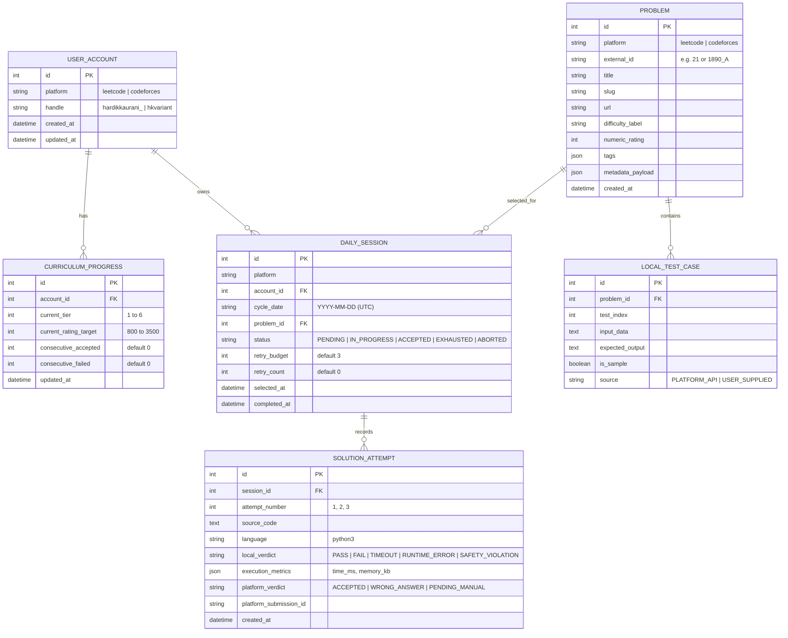
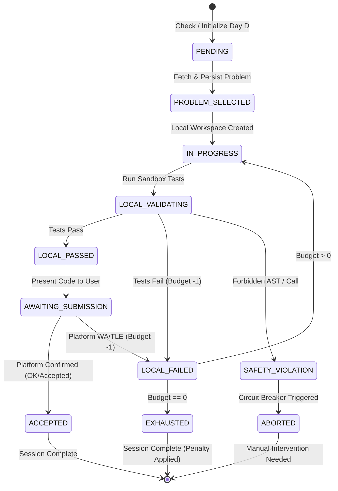
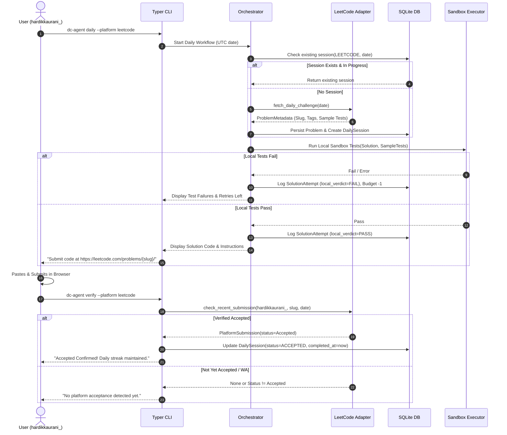
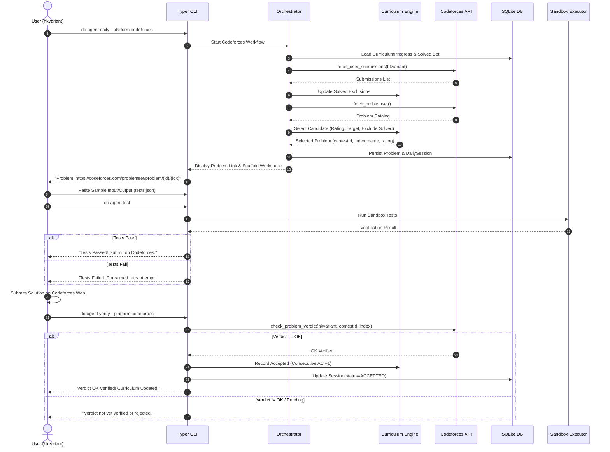

# DC-Agent — System Architecture & Design

## 1. Architectural Philosophy & Overview

DC-Agent follows a **Hexagonal (Ports and Adapters)** monolithic CLI architecture designed for maximum operational simplicity, reliability, and security.

### Core Principles
1. **Local-First & Ephemeral State**: All core decisions and tracking run locally against a single SQLite database file. No external databases, cache servers, or microservices.
2. **Strict Inversion of Control**: Business rules (curriculum progression, daily idempotency, retry budgets) are strictly decoupled from external platform APIs and local execution environments through standard Python `Protocol` interfaces.
3. **Defense-in-Depth Execution**: Code execution is treated as inherently untrusted. A multi-layer sandbox validates AST structure, isolates processes, and constrains OS resources.
4. **Idempotent by Design**: State mutations are atomic. Re-running the tool is always safe and predictable.

```
┌────────────────────────────────────────────────────────────────────────┐
│                               Typer CLI                                │
│                     (daily, status, verify, history)                   │
└───────────────────────────────────┬────────────────────────────────────┘
                                    │
┌───────────────────────────────────▼────────────────────────────────────┐
│                       Workflow Orchestrator                            │
│           (Session lifecycle, retry loops, transaction boundaries)     │
└─────────┬─────────────────────────┬──────────────────────────┬─────────┘
          │                         │                          │
┌─────────▼──────────────┐ ┌────────▼──────────────┐ ┌─────────▼─────────┐
│   Curriculum Engine    │ │   Execution Sandbox   │ │    Data Layer     │
│ (Tiers, Promo/Demo,    │ │ (AST check, timeouts, │ │  (SQLAlchemy 2,   │
│  Solved exclusions)    │ │  Resource limits)     │ │   SQLite + WAL)   │
└─────────┬──────────────┘ └───────────────────────┘ └───────────────────┘
          │
┌─────────▼──────────────────────────────────────────────────────────────┐
│                           Platform Adapters                            │
│  ┌──────────────────────────────────┐┌──────────────────────────────┐  │
│  │         LeetCode Adapter         ││      Codeforces Adapter      │  │
│  │ (Public GraphQL: Daily + Status) ││ (Official REST: API + Status)│  │
│  └──────────────────────────────────┘└──────────────────────────────┘  │
└────────────────────────────────────────────────────────────────────────┘
```

---

## 2. Component Decomposition

### 2.1 CLI Layer (`dc_agent.cli`)
- Implemented with **Typer** and styled with **Rich**.
- Provides straightforward top-level commands:
  - `dc-agent daily [--platform leetcode|codeforces]`: Triggers or resumes the daily challenge cycle.
  - `dc-agent status`: Displays active cycle progress, current rating tier, and retry budget.
  - `dc-agent verify`: Polls platform APIs for confirmed manual submission verdicts.
  - `dc-agent history [--limit N]`: Inspects past sessions, attempt logs, and progression trends.
  - `dc-agent config`: Displays or validates account handles (`hardikkaurani_`, `hkvariant`).

### 2.2 Core Workflow Orchestrator (`dc_agent.core`)
- Coordinates the lifecycle of a daily session:
  1. Identifies the active UTC cycle date.
  2. Resolves or initializes the `DailySession` record atomically.
  3. Coordinates problem retrieval via platform adapters.
  4. Scaffolds local workspace files for user code and tests.
  5. Coordinates local test execution via the `ExecutionSandbox`.
  6. Tracks attempt consumption and manages retry budgets.
  7. Invokes platform verification to detect user-submitted accepted solutions.

### 2.3 Curriculum & Progression Engine (`dc_agent.curriculum`)
- Encapsulates Codeforces difficulty progression and selection logic:
  - Maintains current rating target ($800 \le R \le 3500$) and curriculum tier ($1 \le T \le 6$).
  - Queries user solved history from Codeforces API and creates an exclusion set.
  - Selects eligible candidate problems from `problemset.problems`.
  - Calculates deterministic promotions (+100 rating / tier advance) and demotions (-100 rating / tier fallback).

### 2.4 Platform Adapter Layer (`dc_agent.adapters`)
- Implements external API communication:
  - `LeetCodeAdapter`: Issues unauthenticated GraphQL requests to `https://leetcode.com/graphql`. Handles response normalization, schema extraction, and fallback parsing.
  - `CodeforcesAdapter`: Issues rate-limited requests (max 5 req/s) to `https://codeforces.com/api/` (`problemset.problems`, `user.status`).
- Follows strict timeout management, structured logging, and HTTP error normalization.

### 2.5 Secure Execution Sandbox (`dc_agent.executor`)
- Validates and runs Python solutions:
  - **Static AST Inspector**: Rejects programs with forbidden imports (`os`, `sys`, `socket`, `subprocess`, etc.) or dangerous constructs (`eval`, `exec`, `__import__`).
  - **Subprocess Runner**: Executes code in an ephemeral temporary directory with an empty/minimal environment, pipe-based I/O, and hard wall-clock timeouts.
  - **Resource Governor**: Enforces memory and CPU constraints using platform-specific OS primitives (Windows Job Objects on Windows; `resource` / `prlimit` on Linux).

### 2.6 Persistence Layer (`dc_agent.db`)
- Manages relational storage using **SQLAlchemy 2.0** mapped to SQLite.
- Enables Write-Ahead Logging (`PRAGMA journal_mode=WAL`) and foreign key enforcement (`PRAGMA foreign_keys=ON`).

---

## 3. Platform Adapter Interfaces

The system enforces strict interface contracts using Python `typing.Protocol`.

```python
"""Adapter Interface Definitions for DC-Agent."""

from datetime import date
from enum import StrEnum
from typing import Any, Protocol
from pydantic import BaseModel, Field


class Platform(StrEnum):
    LEETCODE = "leetcode"
    CODEFORCES = "codeforces"


class ProblemDifficulty(StrEnum):
    EASY = "Easy"
    MEDIUM = "Medium"
    HARD = "Hard"


class PlatformVerdict(StrEnum):
    ACCEPTED = "Accepted"
    WRONG_ANSWER = "Wrong Answer"
    TIME_LIMIT_EXCEEDED = "Time Limit Exceeded"
    MEMORY_LIMIT_EXCEEDED = "Memory Limit Exceeded"
    RUNTIME_ERROR = "Runtime Error"
    COMPILATION_ERROR = "Compilation Error"
    PENDING = "Pending"
    UNKNOWN = "Unknown"


class TestCase(BaseModel):
    input_data: str
    expected_output: str
    is_sample: bool = True


class ProblemMetadata(BaseModel):
    platform: Platform
    external_id: str
    title: str
    slug: str
    url: str
    difficulty_label: str
    numeric_rating: int | None = None
    tags: list[str] = Field(default_factory=list)
    raw_content: str | None = None
    sample_test_cases: list[TestCase] = Field(default_factory=list)
    metadata_payload: dict[str, Any] = Field(default_factory=dict)


class PlatformSubmission(BaseModel):
    submission_id: str
    platform: Platform
    problem_identifier: str
    verdict: PlatformVerdict
    timestamp_unix: int
    language: str
    time_consumed_ms: int | None = None
    memory_consumed_bytes: int | None = None


class ILeetCodeAdapter(Protocol):
    """Protocol for LeetCode read-only integrations."""

    async def fetch_daily_challenge(self, target_date: date) -> ProblemMetadata:
        """Fetches the official Daily Coding Challenge for the specified date."""
        ...

    async def check_recent_submission(
        self,
        username: str,
        problem_slug: str,
        min_timestamp_unix: int,
    ) -> PlatformSubmission | None:
        """Checks public profile submissions for an accepted verdict."""
        ...


class ICodeforcesAdapter(Protocol):
    """Protocol for Codeforces official API integrations."""

    async def fetch_problemset(self, tags: list[str] | None = None) -> list[ProblemMetadata]:
        """Fetches problem metadata from problemset.problems."""
        ...

    async def fetch_user_submissions(
        self,
        handle: str,
        from_index: int = 1,
        count: int = 1000,
    ) -> list[PlatformSubmission]:
        """Fetches submission history from user.status."""
        ...

    async def check_problem_verdict(
        self,
        handle: str,
        contest_id: int,
        problem_index: str,
        min_timestamp_unix: int,
    ) -> PlatformSubmission | None:
        """Checks if a user has achieved an OK verdict on a specific problem."""
        ...


class IExecutionSandbox(Protocol):
    """Protocol for isolated local code execution."""

    def run_tests(
        self,
        solution_code: str,
        test_cases: list[TestCase],
        timeout_seconds: float = 2.0,
        memory_limit_mb: int = 256,
    ) -> "ExecutionSummary":
        """Executes test cases against solution code in an isolated environment."""
        ...
```

---

## 4. Database Schema & Entity Relationships

The relational model is designed for strict integrity, normalized attempt tracking, and auditability.



### Table Definitions & Integrity Constraints

#### `user_account`
- `id` INTEGER PRIMARY KEY AUTOINCREMENT
- `platform` VARCHAR(32) NOT NULL
- `handle` VARCHAR(64) NOT NULL
- `created_at` TIMESTAMP DEFAULT CURRENT_TIMESTAMP NOT NULL
- `updated_at` TIMESTAMP DEFAULT CURRENT_TIMESTAMP NOT NULL
- **Constraint**: `UNIQUE(platform, handle)`

#### `curriculum_progress`
- `id` INTEGER PRIMARY KEY AUTOINCREMENT
- `account_id` INTEGER NOT NULL REFERENCES `user_account(id)` ON DELETE CASCADE
- `current_tier` INTEGER NOT NULL DEFAULT 1
- `current_rating_target` INTEGER NOT NULL DEFAULT 800
- `consecutive_accepted` INTEGER NOT NULL DEFAULT 0
- `consecutive_failed` INTEGER NOT NULL DEFAULT 0
- `updated_at` TIMESTAMP DEFAULT CURRENT_TIMESTAMP NOT NULL
- **Constraint**: `CHECK(current_tier BETWEEN 1 AND 6)`
- **Constraint**: `CHECK(current_rating_target >= 800)`
- **Constraint**: `UNIQUE(account_id)`

#### `problem`
- `id` INTEGER PRIMARY KEY AUTOINCREMENT
- `platform` VARCHAR(32) NOT NULL
- `external_id` VARCHAR(64) NOT NULL
- `title` VARCHAR(256) NOT NULL
- `slug` VARCHAR(256) NOT NULL
- `url` VARCHAR(512) NOT NULL
- `difficulty_label` VARCHAR(32) NOT NULL
- `numeric_rating` INTEGER NULL
- `tags` JSON NOT NULL DEFAULT '[]'
- `metadata_payload` JSON NOT NULL DEFAULT '{}'
- `created_at` TIMESTAMP DEFAULT CURRENT_TIMESTAMP NOT NULL
- **Constraint**: `UNIQUE(platform, external_id)`
- **Index**: `idx_problem_platform_rating (platform, numeric_rating)`

#### `daily_session`
- `id` INTEGER PRIMARY KEY AUTOINCREMENT
- `platform` VARCHAR(32) NOT NULL
- `account_id` INTEGER NOT NULL REFERENCES `user_account(id)`
- `cycle_date` VARCHAR(10) NOT NULL
- `problem_id` INTEGER NOT NULL REFERENCES `problem(id)`
- `status` VARCHAR(32) NOT NULL DEFAULT 'PENDING'
- `retry_budget` INTEGER NOT NULL DEFAULT 3
- `retry_count` INTEGER NOT NULL DEFAULT 0
- `selected_at` TIMESTAMP DEFAULT CURRENT_TIMESTAMP NOT NULL
- `completed_at` TIMESTAMP NULL
- **Constraint**: `UNIQUE(platform, cycle_date)` *(Enforces Daily Idempotency)*
- **Index**: `idx_session_lookup (platform, cycle_date, status)`

#### `solution_attempt`
- `id` INTEGER PRIMARY KEY AUTOINCREMENT
- `session_id` INTEGER NOT NULL REFERENCES `daily_session(id)` ON DELETE CASCADE
- `attempt_number` INTEGER NOT NULL
- `source_code` TEXT NOT NULL
- `language` VARCHAR(32) NOT NULL DEFAULT 'python3'
- `local_verdict` VARCHAR(32) NOT NULL
- `execution_metrics` JSON NOT NULL DEFAULT '{}'
- `platform_verdict` VARCHAR(32) NOT NULL DEFAULT 'PENDING_MANUAL'
- `platform_submission_id` VARCHAR(128) NULL
- `created_at` TIMESTAMP DEFAULT CURRENT_TIMESTAMP NOT NULL
- **Constraint**: `UNIQUE(session_id, attempt_number)`

---

## 5. Daily Idempotency & Lifecycle State Machine

The daily workflow transitions through a strictly validated state machine.



### Idempotency Enforcement Mechanism
1. **Date Anchor**: Cycle dates are computed strictly as UTC date strings (`YYYY-MM-DD`).
2. **Transaction Isolation**: Initialization uses SQLite `BEGIN IMMEDIATE` transaction to guarantee that concurrent CLI processes cannot insert duplicate daily records.
3. **Recovery Semantics**:
   - If an existing record exists for `(platform, cycle_date)`:
     - State `ACCEPTED`: Display success banner and exit code 0.
     - State `EXHAUSTED`: Display exhaustion summary, demotion status, and exit code 0.
     - State `IN_PROGRESS` or `AWAITING_SUBMISSION`: Resume the existing session without re-selecting or changing the problem.

---

## 6. Codeforces Rating Progression & Problem Selection

### 6.1 Progression Parameters & Tier Matrix

```
┌──────┬─────────────┬─────────────────────────────────────────────────┐
│ Tier │ Rating Band │ Focus Categories                                │
├──────┼─────────────┼─────────────────────────────────────────────────┤
│ 1    │ 800 - 1000  │ Fundamentals, Implementation, Basic Math        │
│ 2    │ 1100 - 1300 │ Implementation, Greedy, Sorting                 │
│ 3    │ 1400 - 1600 │ Binary Search, Two Pointers, Number Theory      │
│ 4    │ 1700 - 1900 │ Dynamic Programming, Graphs, Constructive       │
│ 5    │ 2000 - 2200 │ Advanced DP, Trees, Data Structures (DSU, Trees)│
│ 6    │ 2300+       │ Expert Combinatorics, Advanced Geometry, Flows  │
└──────┴─────────────┴─────────────────────────────────────────────────┘
```

### 6.2 Formal Progression Rules

Let $R_t$ be the current target rating, $T_t$ be the current tier, $C_{\text{ac}}$ be the consecutive accepted counter, and $C_{\text{fail}}$ be the consecutive failed counter.

#### Promotion Rule
$$\text{If } C_{\text{ac}} = 3:$$
$$R_{t+1} = R_t + 100$$
$$T_{t+1} = \text{tier\_of}(R_{t+1})$$
$$C_{\text{ac}} \leftarrow 0, \quad C_{\text{fail}} \leftarrow 0$$

#### Demotion Rule
$$\text{If } C_{\text{fail}} = 2:$$
$$R_{t+1} = \max(800, R_t - 100)$$
$$T_{t+1} = \text{tier\_of}(R_{t+1})$$
$$C_{\text{fail}} \leftarrow 0, \quad C_{\text{ac}} \leftarrow 0$$

#### Problem Candidate Filter
$$\text{Candidates} = \{ p \in \text{Problemset} \mid \text{rating}(p) = R_t \land p \notin \text{Solved}(hkvariant) \land p \notin \text{RecentExhausted}_{14d} \}$$

If $\text{Candidates}$ is empty, the filter relaxes to:
$$\{ p \in \text{Problemset} \mid \text{rating}(p) \in [\text{Tier}_{\min}, \text{Tier}_{\max}] \land p \notin \text{Solved}(hkvariant) \}$$

#### Tie-Breaking (Deterministic Hashing)
To prevent selection jitter across sessions:
$$\text{Score}(p) = \text{hash}(\text{cycle\_date} \mathbin{\Vert} \text{external\_id}(p)) \pmod{10000} + \text{solvedCount}(p)$$
Select $p \in \text{Candidates}$ with maximum $\text{Score}(p)$.

---

## 7. Secure Local Execution Architecture

Untrusted Python code is subjected to strict multi-tier containment prior to running on the host system.

```
┌────────────────────────────────────────────────────────┐
│                   Untrusted Solution                   │
└───────────────────────────┬────────────────────────────┘
                            │
                            ▼
           ┌─────────────────────────────────┐
           │ Layer 1: AST Security Validator │
           │ - Block forbidden modules       │
           │ - Block eval, exec, open        │
           │ - Verify function signatures    │
           └────────────────┬────────────────┘
                            │ Passed
                            ▼
           ┌─────────────────────────────────┐
           │ Layer 2: Subprocess Isolation   │
           │ - Ephemeral temporary directory │
           │ - Sanitized empty environment   │
           │ - Standard input/output pipes   │
           └────────────────┬────────────────┘
                            │
                            ▼
           ┌─────────────────────────────────┐
           │ Layer 3: OS Resource Governance │
           │ - Strict wall-clock timeout (2s)│
           │ - Memory limits (JobObj/rlimit) │
           │ - Subprocess termination        │
           └─────────────────────────────────┘
```

### AST Security Rules
The static AST visitor traverses the syntax tree and raises `SecurityViolationError` if any of the following are present:
1. **Forbidden Module Imports**: `os`, `sys`, `subprocess`, `shutil`, `socket`, `http`, `urllib`, `requests`, `asyncio`, `pathlib`, `ctypes`, `threading`, `multiprocessing`, `pickle`, `pty`, `posix`, `nt`.
2. **Forbidden Built-in Function Calls**: `eval`, `exec`, `compile`, `__import__`, `open` (in write/append mode), `input` (unless explicitly wrapped in CP harness), `globals`, `locals`.
3. **Forbidden Attribute Access**: Access to dunder attributes like `__subclasses__`, `__globals__`, `__code__`, `__builtins__`.

### Subprocess Execution Boundaries
- **Environment**: `env={}` or minimal sanitized PATH containing only the Python interpreter executable directory. No host environment variables or user home paths are forwarded.
- **Filesystem**: An isolated temporary directory created with `tempfile.TemporaryDirectory()`. The process working directory is locked to this ephemeral location, which is destroyed upon test completion.
- **Resource Limits**:
  - Time Limit: 2.0 seconds wall-clock timeout using `subprocess.run(..., timeout=2.0)`.
  - Process Memory Limit: 256 MB. On Windows, applied via Windows Job Objects (`SetInformationJobObject` with `JobObjectExtendedLimitInformation`). On Linux/macOS, applied via `resource.setrlimit(resource.RLIMIT_AS, (256 * 1024 * 1024, 256 * 1024 * 1024))`.

---

## 8. End-to-End Workflow Sequences

### 8.1 LeetCode Daily Challenge Cycle



### 8.2 Codeforces Progressive Challenge Cycle



